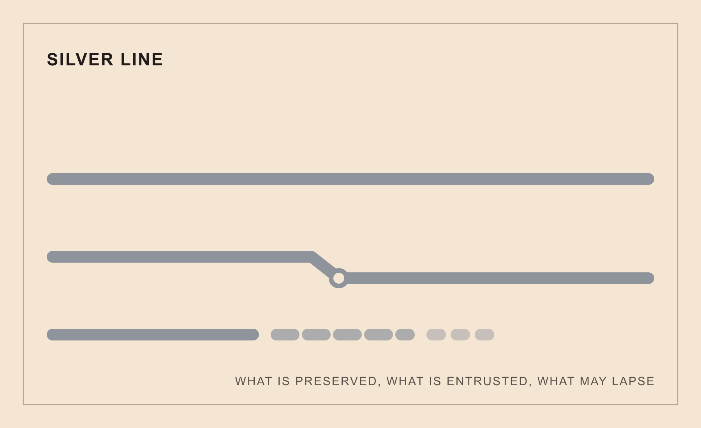

# silver_line

A memory-and-succession line in the docxology line set (admitted 2026-09-01).



## What it is

The Silver Line answers one question: **what do I keep, and how does it
outlive me?** It reads a declared succession picture — what is preserved,
what is entrusted to whom, what is allowed to lapse — and returns a verdict
about declared provision and review gaps, pinned to a registry digest.

## What it is never

An immortality project. An infallible archive. A guarantee of persistence.
A KEPT verdict describes declared custody at a review date; it is never
permission and never a promise that anything survives. See
`docs/claim_boundaries.md`.

## Usage

```python
from silver_line import SuccessionItem, read_succession

verdict = read_succession(
    SuccessionItem(
        item_id="lab-notebooks",
        description="lab notebooks 2024-2026",
        custodian="a named successor",
        tags=frozenset({"record"}),
        evidence=frozenset({"succession_statement", "handoff_note"}),
    ),
    subject_id="lab-archive",
    evaluated_as_of="2026-10-20",
)
print(verdict.status)            # VerdictStatus.NEEDS_REWORK
print(verdict.registry_digest)   # pins the keepsake set used
```

An empty scan set reads `OUTSIDE_SCOPE` with intake notes; a registry that
cannot be scored fails closed as `NEEDS_REWORK`. Malformed input is set
aside with notes, never repaired into a fabricated value.
Malformed Unicode code units, nested container kinds, ordered values and literal
dictionaries are retained in versioned `silver.source/1` snapshots. Complete
same-policy replay uses `restore_source` on original snapshots, not JSON fixture
admission or accepted normalized rows. Root scan identity remains order-insensitive;
historical artifacts require their historical producer.

Findings identify their item and missing fields. Registry lapse eligibility
does not imply a release decision; DECLARED_RELEASE requires a declaration
matching both the explicit reading subject and the exact item ID. Restraint
requirements still apply. For example:

```python
from silver_line import ReleaseDeclaration, SuccessionItem, read_succession

item = SuccessionItem(
    item_id="retired-index",
    description="Synthetic retired index",
    tags=frozenset({"record"}),
    evidence=frozenset({"drift_acknowledgment"}),
    release=ReleaseDeclaration(
        subject_id="archive-a", item_id="retired-index",
        declared_by="declared successor role", declared_on="2026-10-19",
        source_ref="synthetic:release-record",
    ),
)
matching = read_succession(item, subject_id="archive-a", evaluated_as_of="2026-10-20")
mismatched = read_succession(item, subject_id="archive-b", evaluated_as_of="2026-10-20")
assert matching.status.value == "DECLARED_RELEASE"
assert mismatched.status.value == "NEEDS_REWORK"
```

These fields are declarations, not authentication of authority, source
contents, acceptance or consent. Release authorizes no action.
Read `reading_scope` and the accepted/rejected/unmatched counts alongside status.
See [report identity and migration](docs/report-schema.md).

## Verify

```
uv sync
uv run pytest tests/ --cov=src --cov-report=term
uv run ruff check src tests scripts
uv run python scripts/build_figures.py
uv run python scripts/gen_formalism_ledger.py
uv run python -m silver_line.artifacts --check
uv tool run ty==0.0.90 check src
```

Renders via the external template checkout, linked in it at
`projects/working/silver_line` (see `STANDALONE.md`). Pure standard library at
runtime; dev deps are pytest, pytest-cov, and ruff.

## The Line Set

This instrument follows the [current Line Set declaration](https://github.com/docxology/line_set),
whose colorless Main reader holds native instruments apart. Witness
co-registers opaque envelopes without aggregation and remains outside `LINE_SET`:

- [Black Line](https://github.com/docxology/black_line) — declared practice and evidence-label coverage
- [Golden Line](https://github.com/docxology/golden_line) — the aspiration and horizon registry
- [Red Line](https://github.com/docxology/red_line) — the cognitive-security registry of self-assessments
- [White Line](https://github.com/docxology/white_line) — the absence and omission ledger
- [Violet Line](https://github.com/docxology/violet_line) (private; authorized access only) — the consent ledger of affected parties
- [Blue Line](https://github.com/docxology/blue_line) — the stewardship instrument for maintained commitments
- [Green Line](https://github.com/docxology/green_line) — the capacity-under-development instrument
- Copper Line (access-dependent) — allocation arithmetic, not custody or succession
- Iron Line (access-dependent) — scenario-bound recorded recovery comparisons
- [The Line Set](https://github.com/docxology/line_set) — the cross-line set reader holding instruments apart
- [The Witness Register](https://github.com/docxology/witness_register) — co-registration without aggregation

Source availability is separate from family membership: implementations may
be optional or access-controlled. A missing source is not a native verdict.
Silver concerns custody and succession, not Green's learner-owned capacity
markers, Copper's allocation arithmetic (position 9), or Iron's recorded
scenario recovery comparisons (position 10). Copper and Iron are stageless.
Consult the current declaration for membership rather than treating this
orientation as a separately versioned family count.
