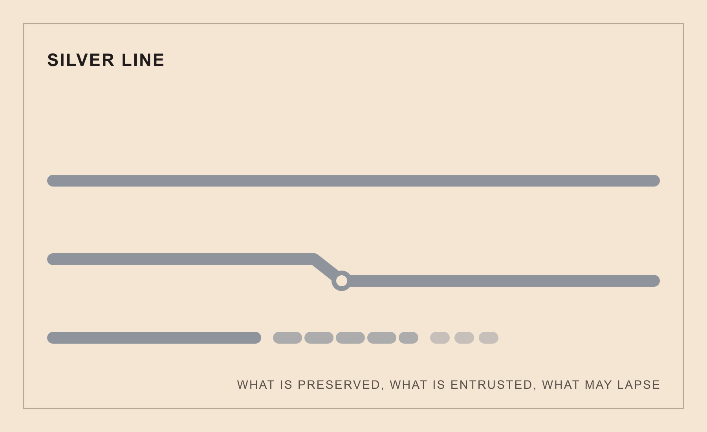

# silver_line

A memory-and-succession line in the docxology line set (admitted 2026-09-01).

## What it is

The Silver Line answers one question: **what do I keep, and how does it
outlive me?** It reads a declared succession picture — what is preserved,
what is entrusted to whom, what is allowed to lapse — and returns a verdict
about declared provision and review gaps, pinned to a registry digest.

## What it is never

An immortality project. An infallible archive. A guarantee of persistence.
A KEPT verdict describes declared custody at a review date; it is never
permission and never a promise that anything survives. See the
[claim boundaries](docs/claim_boundaries.md).

## Documentation

Start with the [documentation index](docs/README.md) for setup, native
verification, and the canonical manuscript. The [usage guide](docs/usage.md)
shows dated reads and subject-bound release declarations. The
[report schema](docs/report-schema.md) covers provenance and replay.

Build and verify the PDF and HTML with the
[pinned template commands](docs/development.md#render-and-validate-the-manuscript).
Silver Line's runtime uses Python 3.11 or later and the standard library.

## The Line Set

This instrument follows the [current Line Set declaration](https://github.com/docxology/line_set),
whose colorless Main reader holds native instruments apart. Witness
co-registers opaque envelopes without aggregation and remains outside `LINE_SET`:

- [Black Line](https://github.com/docxology/black_line) — declared practice and evidence-label coverage
- [Golden Line](https://github.com/docxology/golden_line) — the aspiration and horizon registry
- [Red Line](https://github.com/docxology/red_line) — the cognitive-security registry of self-assessments
- [White Line](https://github.com/docxology/white_line) — the absence and omission ledger
- [Violet Line](https://github.com/docxology/violet_line) (private; authorized access only) — the consent ledger of affected parties
- [Blue Line](https://github.com/docxology/blue_line) — the stewardship instrument for maintained commitments
- [Green Line](https://github.com/docxology/green_line) — the capacity-under-development instrument
- Copper Line (access-dependent) — allocation arithmetic, not custody or succession
- Iron Line (access-dependent) — scenario-bound recorded recovery comparisons
- [The Line Set](https://github.com/docxology/line_set) — the cross-line set reader holding instruments apart
- [The Witness Register](https://github.com/docxology/witness_register) — co-registration without aggregation

Source availability is separate from family membership: implementations may
be optional or access-controlled. A missing source is not a native verdict.
Silver concerns custody and succession, not Green's learner-owned capacity
markers, Copper's allocation arithmetic (position 9), or Iron's recorded
scenario recovery comparisons (position 10). Copper and Iron are stageless.
Consult the current declaration for membership rather than treating this
orientation as a separately versioned family count.
